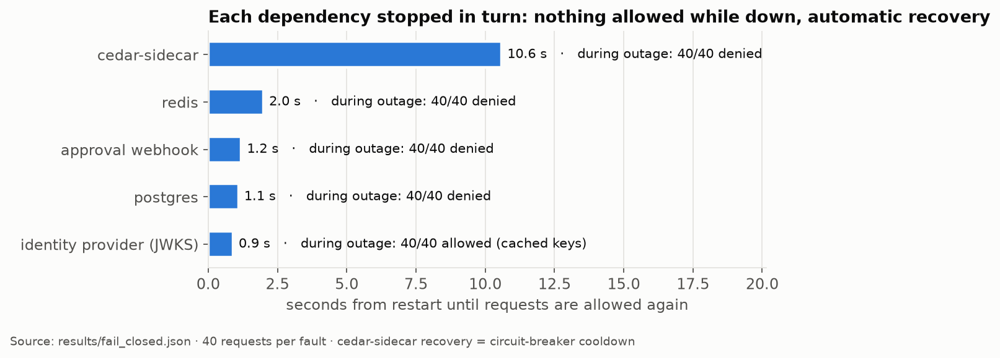
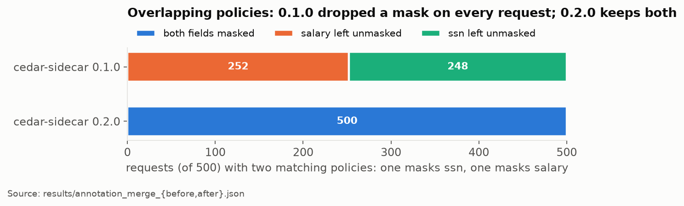
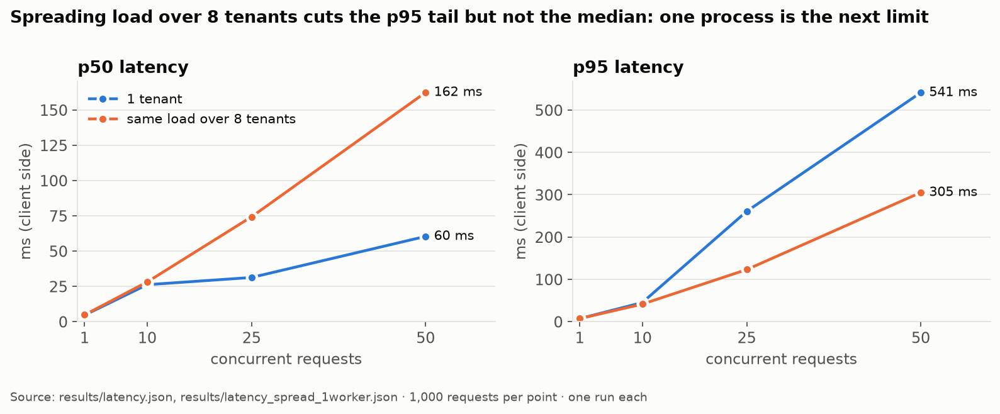
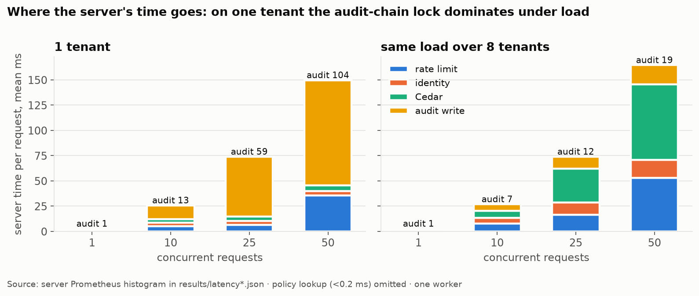

# Aegis

**A policy checkpoint for AI agent tool calls: before a tool runs, Aegis decides whether this user, through this agent, may do this, and fails closed when it cannot tell.**

An agent that can call tools can move money, read payroll, or email customers. The model decides *what* to call; something else has to decide whether the call is *allowed*. Most teams write that check by hand in each agent, against each framework's hooks, and it ends up inconsistent and quietly fails open when a dependency is down.

Aegis puts the decision in one place. Your agent framework asks Aegis before each tool call. Aegis checks two tokens (the person's and the agent's), evaluates your [Cedar](https://www.cedarpolicy.com) policy, asks a human when the policy says so, records the decision in a tamper-evident log, and answers:

```
ALLOW  and mask ssn, compensation in the result
DENY   "Access Denied: 'transfer_large_funds' requires approval that was not granted."
```

A denial reaches the model as an ordinary tool result it can read and recover from, not an exception that ends the run.

**Status: alpha (0.2).** Tested end to end with a 23-case attack suite and fault injection; not yet run in production by anyone. See [Limits](#limits).

- [How it works](#how-it-works) · [Quickstart](#quickstart) · [Use it from your agent](#use-it-from-your-agent)
- [Why it fails closed](#why-it-fails-closed) · [Evidence](#evidence) · [What you get](#what-you-get)
- [Limits](#limits) · [Guides](#guides) · [Reproduce](#reproduce) · [Layout](#repository-layout)

## How it works

```
 agent framework          aegis-server                                   cedar-sidecar (Rust)
 (LangGraph, CrewAI,      ─────────────────────────────────────────      real cedar-policy crate
  Semantic Kernel,  ───▶  1 rate limit (per tenant)                 ───▶ evaluate policy,
  OpenAI Agents,          2 verify the user's and agent's tokens    ◀─── return decision +
  MCP)                    3 load the tenant's policy (cached)              merged annotations
        ▲                 4 Cedar decision
        │                 5 approval webhook, if the policy asks    ───▶ your approval system
        │                 6 append to the tenant's audit chain      ───▶ Postgres
        └──────────────── ALLOW + obligations, or DENY + message
```

1. **The adapter intercepts a tool call** through the framework's own hook (LangGraph's `wrap_tool_call`, CrewAI's tool hooks, Semantic Kernel's invocation filter, OpenAI Agents' tool guardrails, or a decorator on an MCP tool).
2. **aegis-server verifies who is acting.** Two JWTs: the end user's and the agent's own. Both must verify against the tenant's identity provider (signature, issuer, expiry, optionally audience; optionally single use). The effective principal is the person *and* the agent: a policy can require both.
3. **Cedar decides.** The tenant's policy is evaluated by the official Rust `cedar-policy` crate. Cedar denies by default, and `forbid` beats `permit`.
4. **Annotations become obligations.** Policies can carry `@mask_fields("ssn,salary")`, `@approval_required("true")` and `@risk_tier("low")`. When several policies allow a call, their annotations are merged strictly: all masks, approval if any requires it.
5. **Approval, if required.** Low-risk actions are approved automatically; others go to your approval webhook over an HMAC-signed request and response, bound to a nonce.
6. **The decision is recorded** in a per-tenant hash chain keyed with a secret the database does not hold. Editing, inserting or deleting a past entry breaks the chain.
7. **The adapter acts on the answer**: runs the tool and masks its output, or returns the denial to the model.

Details: [concepts](docs/guide/concepts.md), [architecture](docs/architecture.md).

## Quickstart

You need Docker and Python 3.11+.

```bash
git clone https://github.com/Dharan1729/aegis && cd aegis
python -m venv .venv && . .venv/bin/activate
pip install -e aegis-sdk -e aegis-cli "pyjwt[crypto]" httpx

python scripts/gen_test_keys.py          # dev signing key for the local identity provider
docker compose up --build -d             # Postgres, Redis, cedar-sidecar, aegis-server, mocks
python scripts/seed_tenant.py            # demo tenant "acme": identity, schema, policy
python examples/quickstart.py            # every outcome, through the SDK, no LLM needed
```

The last command prints:

```
An analyst queries payroll: allowed, ssn and compensation masked
  ALLOW
         [{"employee": "Ada", "ssn": "[MASKED]", "compensation": "[MASKED]", "team": "Core"}]
A junior analyst tries the same query: no policy permits it
  DENY   Access Denied: 'execute_query' is not permitted on 'urn:tool:execute_query' for this principal.
A manager makes a small transfer: approval required, low risk, auto-approved
  ALLOW (approved by auto (low risk))
A medium transfer: sent to the approval webhook, approved
  ALLOW (approved by mock-approver)
A large transfer: sent to the approval webhook, refused
  DENY   Access Denied: 'transfer_large_funds' requires approval that was not granted (...)
aegis-server unreachable: the guard denies instead of failing open
  DENY   Access Denied: unable to verify authorization for 'execute_query' (ConnectError).
```

The policy behind it is [examples/policies/acme.cedar](examples/policies/acme.cedar). Walkthrough: [docs/guide/quickstart.md](docs/guide/quickstart.md).

## Use it from your agent

```bash
pip install -e "aegis-sdk[langgraph]"    # or crewai, semantic-kernel, openai-agents, mcp
```

```python
from aegis import AegisClient
from aegis.adapters.langgraph import SecureToolNode

tools = SecureToolNode([query_payroll, transfer_funds], aegis_client=AegisClient("http://localhost:8000"))
# Use it wherever you used ToolNode. Identity comes from the run config:
graph.invoke(inputs, config={"configurable": {"aegis": {
    "tenant_id": "acme", "human_token": user_jwt, "service_token": agent_jwt,
    "session_id": session_id, "workflow_id": "payroll-assistant",
}}})
```

| Framework | Hook | Entry point |
|---|---|---|
| LangGraph | `ToolNode` `wrap_tool_call` | `SecureToolNode`, plus `GovernedCheckpointer` to refuse resuming a run after its policy changed |
| CrewAI | global `before_tool_call` / `after_tool_call` | `register_aegis_hooks`, or `SecureTool` per tool |
| Semantic Kernel | function-invocation filter | `make_aegis_function_filter` |
| OpenAI Agents SDK | tool input and output guardrails | `make_aegis_tool_guardrails` |
| MCP servers | decorator on the tool handler | `@governed(...)` |
| anything else | two calls | `Guard.check()` before, `Guard.finish()` after |

All six share one core ([`aegis/core.py`](aegis-sdk/aegis/core.py)), so failure handling and masking are identical everywhere. Per-framework details: [docs/guide/adapters.md](docs/guide/adapters.md).

## Why it fails closed

Every path that is not a positive, verified, recorded `ALLOW` is a `DENY`.

- **Any failure in the pipeline is a denial.** Identity, policy lookup, Cedar, approval, Redis, Postgres: each failure becomes a `DENY` with a readable message and an audit entry, never a 500. Measured: 0 allows and 0 errors across six fault types ([B2](docs/benchmarks.md#b2-fault-injection-does-anything-fail-open)).
- **An unrecorded decision is a denial.** If the audit write fails, the answer is `DENY`, even when the policy allowed it.
- **The SDK cannot fail open.** `Guard.check` never raises: a network error, a 5xx, or an exception while working out who is calling all become denials. This matters most in CrewAI, whose hook dispatcher runs the tool anyway if a hook raises.
- **Identity is checked twice, independently.** Both tokens must verify against the tenant's configured issuer. A tenant with no issuer configured denies everything. Tokens from another tenant, another issuer, `alg: none`, or HS256 signed with the public key are refused ([B1](docs/benchmarks.md#b1-attacks-on-the-decision-endpoint)).
- **The agent's identity comes from its token, never the request.** Server-derived fields overwrite anything a caller puts in the request context, so an agent cannot claim to be a more trusted one.
- **Approvals are signed both ways.** A webhook without a shared secret is refused at configuration time; an unsigned, mis-signed or replayed approval is a denial.
- **Unmaskable output is withheld.** If a policy says to mask `ssn` and the tool returns free text, the SDK returns a denial instead of guessing (configurable).
- **Production refuses dev settings.** With `ENVIRONMENT=production`, the server will not start with the development audit secret, the development identity provider, or a localhost CORS origin.

The threat model, including what Aegis does *not* protect against, is in [SECURITY.md](SECURITY.md).

## Evidence

Everything here comes from [docs/benchmarks.md](docs/benchmarks.md); each number is in a committed file under [`results/`](results/) and can be reproduced with one command.

**Attacks: 19 of 19 refused, 4 of 4 legitimate controls allowed, 0 server errors.** Forged signatures, algorithm confusion, `alg: none`, cross-tenant and cross-issuer tokens, replay, expiry, agent impersonation through the request context, and Cedar syntax injected into action and resource names ([B1](docs/benchmarks.md#b1-attacks-on-the-decision-endpoint)).

**Fault injection: 0 fail-open allows in 240 requests** sent while one dependency at a time was down. Every request got a decision rather than an error, in about the time a healthy request takes, and service resumed on its own after each restart.

| Dependency stopped | During the outage | Allowed again after restart |
|---|---|---|
| cedar-sidecar | 40 of 40 denied | 10.6 s (circuit-breaker cooldown) |
| Redis | 40 of 40 denied | 2.0 s |
| Postgres | 40 of 40 denied | 1.1 s |
| approval webhook | 40 of 40 denied | 1.2 s |
| aegis-server (SDK side) | 40 of 40 denied | n/a |



**A masking bug, found and fixed.** With two policies each masking a different field, the 0.1.0 sidecar dropped one of the fields on **500 of 500** requests (annotations were merged last-write-wins). 0.2.0 merges them strictly and masked both on 500 of 500 ([B3](docs/benchmarks.md#b3-overlapping-policies-and-masking-a-bug-found-and-fixed)).



**Latency: under 5 ms per decision unloaded** (p50 4.6 ms, p99 10.8 ms, client side, including the audit write). One replica handled about 300 to 350 decisions per second. Under load the limit is the per-tenant audit chain, which records one tenant's decisions one at a time; spreading the same load over 8 tenants cut the p95 at 25 concurrent clients from 261 ms to 123 ms ([B4](docs/benchmarks.md#b4-latency-throughput-and-where-the-time-goes)).

| Concurrency | Throughput | p50 | p95 | p99 |
|---|---|---|---|---|
| 1 | 201 req/s | 4.6 ms | 7.1 ms | 10.8 ms |
| 10 | 350 req/s | 26.2 ms | 45.2 ms | 61.2 ms |
| 25 | 318 req/s | 31.3 ms | 261 ms | 326 ms |
| 50 | 310 req/s | 60.4 ms | 541 ms | 797 ms |

One replica, one tenant, one laptop, single runs. Four worker processes per container behaved unpredictably under high concurrency (B4 has the data); scale with replicas instead.





## What you get

| | |
|---|---|
| **Decision runtime** | `POST /v1/evaluate`: two-token identity, per-tenant rate limit, Cedar, obligations, approvals, audit. `/health`, `/ready`, `/metrics`. |
| **Cedar, for real** | The official Rust `cedar-policy` crate in a small sidecar: evaluation, and strict schema validation of policies before they are saved. |
| **Obligations** | `@mask_fields`, `@approval_required`, `@risk_tier` annotations, merged strictly across matching policies and enforced by the SDK. |
| **Approvals** | Webhook with HMAC-signed, nonce-bound request and response; automatic approval for low-risk actions. |
| **Tamper-evident audit** | Per-tenant HMAC hash chain; `scripts/verify_audit_chain.py` re-verifies it independently, including on a restored backup. |
| **Admin API, CLI, UI** | Tenants, policies (validated, versioned, pushed to every replica at once), schemas, audit log; `aegisctl`; a small policy editor at `/admin-ui`. OIDC-protected. |
| **Five framework adapters** | One shared core; masking and fail-closed behaviour identical in all of them. |
| **Operations** | OpenTelemetry tracing, Prometheus metrics with a per-stage latency histogram, Alembic migrations safe under concurrent replicas, non-root images with health checks, SBOM and vulnerability scan in CI. |

## Limits

- **Alpha.** Nobody runs this in production yet. APIs may change.
- **Tokens are your problem.** Aegis verifies the end user's and the agent's JWTs; it does not issue them. The default single-use mode expects a fresh token pair per tool call (a token exchange in front of Aegis); set `single_use_tokens: false` per tenant to accept ordinary reusable access tokens ([tenants guide](docs/guide/tenants.md)).
- **One tenant's decisions are recorded one at a time.** The audit chain needs a lock per tenant. Around 300 decisions per second per tenant on a laptop; more tenants spread the load.
- **The audit chain is tamper-evident, not tamper-proof.** Anyone holding both database access and the HMAC secret (for example, a compromised aegis-server) can rewrite history. Ship the chain head somewhere append-only if that matters to you.
- **Masking needs structured output.** Dicts, lists, pydantic models and JSON strings are masked by key; free text is withheld by default.
- **The resource is coarse by default.** Adapters authorize `urn:tool:<name>`. To authorize on arguments (which table, which account), write a resource resolver.
- **Policy-version checks are unauthenticated.** `GET /v1/policy-version/{tenant}` returns only a hash, so anyone who can reach it can tell which tenant IDs exist.
- **Tested on one machine.** Multi-replica deployments, managed Postgres and real identity providers are documented but not benchmarked.
- **Not compared with alternatives.** There are other agent-authorization projects and platform features; this repository does not benchmark against them.

## Guides

- [Quickstart](docs/guide/quickstart.md): the demo, step by step
- [Concepts](docs/guide/concepts.md): execution principal, decisions, obligations, failing closed
- [Writing policies](docs/guide/policies.md): Cedar for agents, annotations, schemas, validation
- [Tenants and identity](docs/guide/tenants.md): issuers, audiences, single-use tokens
- [Framework adapters](docs/guide/adapters.md): LangGraph, CrewAI, Semantic Kernel, OpenAI Agents, MCP
- [Approvals](docs/guide/approvals.md): the signed webhook protocol
- [Audit log](docs/guide/audit.md): the hash chain and verifying it
- [API reference](docs/guide/api.md)
- [Deployment](docs/guide/deployment.md): configuration reference, production checklist, scaling
- [Operations](docs/guide/operations.md): SLOs, incident playbooks, backup and restore
- [Architecture](docs/architecture.md), [Benchmarks](docs/benchmarks.md), [Changelog](CHANGELOG.md), [Security](SECURITY.md), [Contributing](CONTRIBUTING.md)

## Reproduce

| Claim | Command |
|---|---|
| Every test (Rust, server unit and integration, SDK) | see [CONTRIBUTING.md](CONTRIBUTING.md#tests) |
| Attack suite | `python -m benchmarks.attacks` → `results/attacks.json` |
| Fault injection | `python -m benchmarks.fail_closed` → `results/fail_closed.json` |
| Masking merge | `python -m benchmarks.annotation_merge --url http://localhost:8180 --label after` |
| Latency | `python -m benchmarks.latency` → `results/latency.json` |
| Figures | `pip install matplotlib && python -m benchmarks.plots` → `results/figures/` (reads only committed results) |
| Everything | `bash scripts/reproduce.sh` |

Set `AEGIS_RESULTS_DIR=out` to keep the committed results untouched.

## Repository layout

```
cedar-sidecar/    Rust: Cedar evaluation and validation, strict annotation merge
aegis-server/     Python/FastAPI: decision pipeline, admin API, migrations, tests
aegis-sdk/        Python: Guard, masking, and the five framework adapters
aegis-cli/        aegisctl: tenants, policies, audit log, dev helpers
approval-mock/    stand-in approval webhook for the demo and tests
benchmarks/       attack suite, fault injection, masking merge, latency
results/          committed benchmark output
examples/         quickstart.py, sample policy, schema and tenant config
scripts/          dev keys, token minting, seeding, smoke test, audit verification
docs/             guides, architecture, benchmarks
```

## License

Apache-2.0. See [LICENSE](LICENSE). Aegis uses the open-source [`cedar-policy`](https://crates.io/crates/cedar-policy) crate (Apache-2.0) and is not affiliated with the Cedar project.
