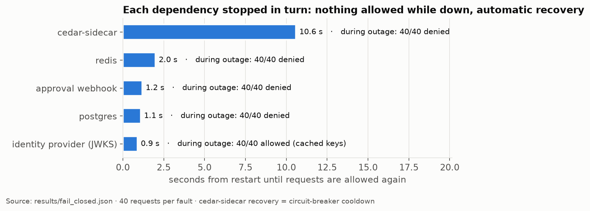
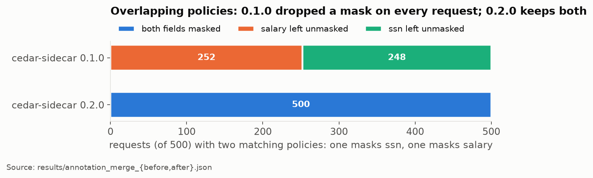
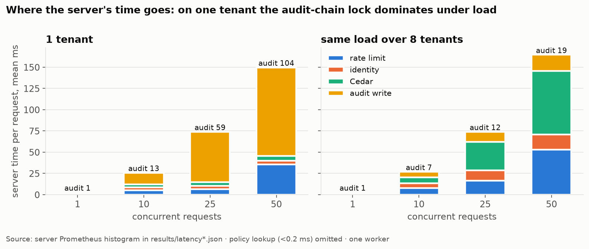
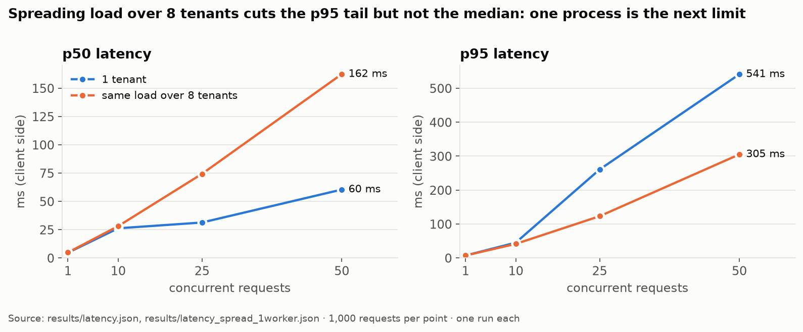

# Benchmarks

Every number in the README comes from this page, and every number on this page comes from a file in [`results/`](../results/) written by a script in [`benchmarks/`](../benchmarks/). Nothing is typed in by hand. Each section says how to reproduce it and what it does not show.

**Setup for all runs** (recorded in each results file): the repository's `docker-compose.yml` on one Apple-silicon laptop (Docker Desktop, 14 CPUs), one `aegis-server` replica, Postgres 16, Redis 7, the Rust `cedar-sidecar` built from this repository. The benchmark client runs on the same machine. Date: November 2026.

- [B1. Attacks on the decision endpoint](#b1-attacks-on-the-decision-endpoint)
- [B2. Fault injection: does anything fail open?](#b2-fault-injection-does-anything-fail-open)
- [B3. Overlapping policies and masking (a bug found and fixed)](#b3-overlapping-policies-and-masking-a-bug-found-and-fixed)
- [B4. Latency, throughput, and where the time goes](#b4-latency-throughput-and-where-the-time-goes)
- [Reproduce](#reproduce)

---

## B1. Attacks on the decision endpoint

**Question.** Can a caller of `POST /v1/evaluate` get an `ALLOW` it should not get?

**Method.** [`benchmarks/attacks.py`](../benchmarks/attacks.py) sets up a tenant through the admin API and sends 23 requests: 19 attacks and 4 controls. An attack passes if it is refused (a `DENY`, or a 4xx with no decision) without a server error. The controls are legitimate requests that must still be allowed with the right obligations, so a server that denies everything cannot pass.

**Result.** 19 of 19 attacks refused, 4 of 4 controls passed, 0 server errors. Raw: [`results/attacks.json`](../results/attacks.json).

| Kind | Case | Got |
|---|---|---|
| identity | token signed with an attacker's key | DENY |
| identity | algorithm confusion: HS256 signed with the server's public RSA key | DENY |
| identity | unsigned token (`alg: none`) | DENY |
| identity | token from another issuer | DENY |
| identity | another tenant's valid tokens sent under this tenant's header | DENY |
| identity | the agent's service token presented as the user's token | DENY |
| identity | expired token | DENY |
| identity | token issued in the future | DENY |
| identity | token without a `jti` (single-use tenant) | DENY |
| identity | the same token pair sent twice (replay) | DENY on the second use |
| identity | unknown tenant | DENY |
| identity | garbage token | DENY |
| identity | `Authorization` header without `Bearer` | HTTP 401 |
| policy | role no policy permits (Cedar default deny) | DENY |
| policy | `forbid` and `permit` both match | DENY |
| policy | high-risk action the approver refuses | DENY |
| policy | caller puts `agent_id: "trusted-batch-agent"` in the request context to impersonate a trusted agent | DENY |
| policy | Cedar syntax injected into the action name | DENY |
| policy | Cedar syntax injected into the resource URN | DENY |
| control | analyst reads a report | ALLOW |
| control | two permits match; both masking obligations returned (`salary`, `ssn`) | ALLOW |
| control | the trusted agent exports (its identity comes from its token) | ALLOW |
| control | first use of a token pair | ALLOW |

**Limits.** These are the attacks we thought of. They are not a substitute for an external review. Unit tests cover the same identity cases without a running stack (`aegis-server/tests/unit/test_principal_validator.py`).

---

## B2. Fault injection: does anything fail open?

**Question.** When a dependency is down, does Aegis deny, answer with a decision rather than an error, and recover on its own?

**Method.** [`benchmarks/fail_closed.py`](../benchmarks/fail_closed.py) stops one compose service at a time, sends 40 requests that are *allowed* when the stack is healthy, restarts the service, and measures how long until requests are allowed again (five in a row). Any `ALLOW` during a fault would be a fail-open. The last row stops nothing on the server side: it points the SDK's `Guard` at an address where nothing listens.

**Result.** 0 fail-open allows and 0 errors instead of decisions, across 240 requests during faults. Raw: [`results/fail_closed.json`](../results/fail_closed.json).

| Fault | Requests during the fault | p50 / max latency | Allowed again after restart |
|---|---|---|---|
| none (control) | 40 ALLOW | 5.9 / 15.6 ms | n/a |
| cedar-sidecar stopped | 40 DENY | 3.9 / 35.6 ms | 10.6 s |
| Redis stopped | 40 DENY | 6.7 / 16.4 ms | 2.0 s |
| Postgres stopped | 40 DENY | 10.4 / 45.1 ms | 1.1 s |
| approval webhook stopped (approval-required action) | 40 DENY | 11.9 / 25.2 ms | 1.2 s |
| identity provider's JWKS stopped | 40 ALLOW, see below | 3.9 / 12.4 ms | 0.9 s |
| aegis-server unreachable (SDK side) | 40 DENY | 0.6 / 13.5 ms | n/a |



- **Denials are fast.** Requests during a fault were denied in about the time a healthy request takes. Nothing waited out a long timeout: cedar-sidecar's client trips a circuit breaker after 5 consecutive connection failures and then fails immediately.
- **Recovery after a cedar-sidecar outage takes about 10 s.** That is the circuit breaker's cooldown (`_BREAKER_RECOVERY_SECONDS`). After it, one trial request is let through; if it succeeds, the breaker closes.
- **A JWKS outage does not deny, by design.** Signing keys already fetched stay cached in the server, as with any OIDC relying party, so tokens signed with a known key keep verifying. A token signed with a new key would fail until the JWKS is back.
- **Postgres down means the audit log cannot be written, so even an otherwise allowed request is denied.** Aegis does not allow what it cannot record.

**What changed to get here.** In 0.1.0, decision failures other than identity, missing policy and Cedar errors were not caught. From reading that code (not measured, because the 0.1.0 stack had no admin API for this script to drive): a Redis or Postgres outage made `/v1/evaluate` return HTTP 500 rather than a `DENY`, and four of the five SDK adapters (all but CrewAI's hooks) raised into the agent loop when their call to aegis-server failed, rather than returning a denial. Both were still fail-safe, because the tool did not run, but they broke the "a denial is a message the agent can read" contract. In the same pass, the Redis invalidation listener was found to stop for good after one Redis disconnect, leaving policy updates to arrive only through the 5-second local cache expiry. It now reconnects with backoff (unit test: `test_policy_store.py`).

**Limits.** One replica, one fault at a time, 40 requests per fault. Network partitions, slow (rather than stopped) dependencies, and faults during a policy update are not tested.

---

## B3. Overlapping policies and masking (a bug found and fixed)

**Question.** When two policies both allow a request and each names fields to mask, are all of those fields masked?

**Method.** [`benchmarks/annotation_merge.py`](../benchmarks/annotation_merge.py) sends one `/authorize` request 500 times to a cedar-sidecar. Two policies match it: one says `@mask_fields("ssn")`, the other `@mask_fields("salary")`. It counts how often the response leaves one of those fields out. It was run against the 0.1.0 sidecar and the 0.2.0 sidecar.

**Result.** Raw: [`results/annotation_merge_before.json`](../results/annotation_merge_before.json), [`results/annotation_merge_after.json`](../results/annotation_merge_after.json).

| cedar-sidecar | Both fields masked | `ssn` left unmasked | `salary` left unmasked |
|---|---|---|---|
| 0.1.0 | 0 of 500 | 248 | 252 |
| **0.2.0** | **500 of 500** | 0 | 0 |



0.1.0 copied each matching policy's annotations into one map, so the last policy read won, and the order changed from request to request. Every request lost one of the two fields. The same happened to `approval_required` and `risk_tier`: a policy requiring approval could be overridden by another that did not.

0.2.0 merges annotations strictly ([`cedar-sidecar/src/lib.rs`](../cedar-sidecar/src/lib.rs), `merge_annotations`): masked fields are the union, approval is required if any policy requires it, and the risk tier is the most severe, so a low-risk auto-approval happens only when every allowing policy says `low`. The result no longer depends on order. Seven Rust unit tests and one integration test cover these rules; the attack suite's second control case checks it end to end.

---

## B4. Latency, throughput, and where the time goes

**Question.** How long does a decision take, how many can one replica make, and which stage limits it?

**Method.** [`benchmarks/latency.py`](../benchmarks/latency.py) sends 1,000 allowed requests at concurrency 1, 10, 25 and 50, with tokens minted before the clock starts. Client-side latency includes the HTTP round trip. Stage times come from the server's own Prometheus histogram (`aegis_evaluate_stage_latency_seconds`), read before and after each run. Each configuration ran once.

### One tenant, one worker

Raw: [`results/latency.json`](../results/latency.json).

| Concurrency | Throughput | p50 | p95 | p99 | Server stage means (ms): rate limit / identity / Cedar / audit write |
|---|---|---|---|---|---|
| 1 | 201 req/s | 4.6 ms | 7.1 ms | 10.8 ms | 0.6 / 0.4 / 0.8 / 1.1 |
| 10 | 350 req/s | 26.2 ms | 45.2 ms | 61.2 ms | 5.3 / 3.3 / 3.8 / 13.5 |
| 25 | 318 req/s | 31.3 ms | 261 ms | 326 ms | 6.4 / 3.9 / 4.7 / 59.0 |
| 50 | 310 req/s | 60.4 ms | 541 ms | 797 ms | 35.7 / 4.3 / 5.4 / 104.3 |

- **Unloaded, a decision takes under 5 ms end to end.** About 2.7 ms of that is server work: identity, Cedar, and a synchronous audit write. Policy lookup is under 0.1 ms because policies are cached in-process and invalidated by push.
- **Under load, the audit write dominates.** Each tenant's audit log is one hash chain, and appending to it takes a row lock on that tenant's chain head, so one tenant's decisions are recorded one at a time. That is the price of a chain in which no entry can be inserted, reordered or removed without detection.
- **Single-use tokens cost a Redis write per token.** Identity checks took 0.2 ms with reusable tokens against 0.4 to 4.3 ms with single-use tokens (the replay guard writes each token's `jti`). Throughput was within run-to-run noise of each other (raw file, `reusable_tokens`).



### The same load spread over 8 tenants

Raw: [`results/latency_spread_1worker.json`](../results/latency_spread_1worker.json).

| Concurrency | Throughput | p50 | p95 | p99 | Audit write mean |
|---|---|---|---|---|---|
| 10 | 325 req/s | 28.1 ms | 41.4 ms | 123 ms | 6.5 ms (vs 13.5) |
| 25 | 310 req/s | 74.3 ms | 123 ms | 161 ms | 11.9 ms (vs 59.0) |
| 50 | 281 req/s | 162 ms | 305 ms | 410 ms | 19.0 ms (vs 104.3) |

Spreading the load removed most of the audit-lock wait and halved p95 at concurrency 25 and 50, which confirms the per-tenant lock as the cause of the single-tenant tail. Throughput did not rise and the median got worse: with the lock gone, every stage slowed evenly. That is the signature of one Python process saturating its event loop. The next limit is CPU in a single process.



### Four worker processes

Raw: [`results/latency_4workers.json`](../results/latency_4workers.json), and a repeat of the spread run, [`results/latency_4workers_repeat.json`](../results/latency_4workers_repeat.json). Stage means are omitted because each `/metrics` scrape reads only one worker's counters.

| Load | c=10 | c=25 | c=50 |
|---|---|---|---|
| one tenant, single-use tokens | 527 req/s | 513 req/s | 546 req/s (p95 288 ms) |
| 8 tenants (first run / repeat) | 903 / 827 req/s | 327 / 315 req/s | 186 / 183 req/s (p95 793 / 824 ms) |

At concurrency 10, four workers raised throughput to 527 to 903 requests per second. **At concurrency 25 and 50 with 8 tenants, throughput fell to about 185 req/s, below one worker.** The repeat run reproduced it. What we ruled out: Postgres was not the bottleneck (sampled during the run, its connections were idle with no lock waits), and disabling `synchronous_commit` did not change it. The cause is not yet known. Until it is, scale by adding replicas, each with one worker, rather than workers per container ([deployment guide](guide/deployment.md#scaling)).

**Limits.** One run per configuration on a shared laptop: differences under about 15% are within noise. Client and server share the machine. Single replica only; multi-replica throughput is not measured. Approval-webhook round trips are excluded (the policy here needs no approval). Production hardware, a managed Postgres, and network latency between services will all change these numbers.

---

## Reproduce

```bash
python scripts/gen_test_keys.py
docker compose up --build -d
pip install -e "aegis-server[test]" -e aegis-sdk asyncpg

python -m benchmarks.attacks                 # B1, about 2 s
python -m benchmarks.fail_closed             # B2, about 1 min; stops and restarts compose services
python -m benchmarks.annotation_merge --url http://localhost:8180 --label after   # B3
python -m benchmarks.latency                 # B4, about 2 min
```

Figures: `pip install matplotlib && python -m benchmarks.plots` redraws `results/figures/` from the committed JSON.

Or all of them: `bash scripts/reproduce.sh`. Set `AEGIS_RESULTS_DIR=out` to keep your results from overwriting the committed ones. For the 4-worker rows, start the stack with `AEGIS_WORKERS=4` and pass `--server-workers 4`.
